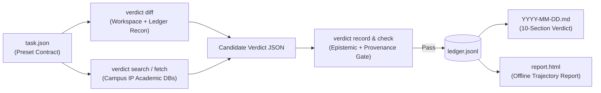

# verdict

**Evidence-graded verdicts for research projects, technical systems, and startups.**

`verdict` is a zero-dependency Python CLI (`verdict`) and dual-harness agent plugin/skill (`Antigravity` + `Claude Code`) that keeps project evaluations honest over time. It pairs LLM synthesis with a **deterministic epistemic linter**, **local campus-network academic database search** (ScienceDirect, IEEE Xplore, ACM DL, Springer, arXiv, OpenAlex, Semantic Scholar), an **append-only JSONL ledger**, and a **single-file offline HTML trajectory report**.

Inspired by [`local-autoresearch`](https://github.com/conglu1997/local-autoresearch)'s separation of declarative task contracts, mechanical check gates, structured run logs, and self-contained HTML reports—adapted for R&D, systems engineering, and startup go/no-go decisions where rules are stated before data is seen.

---

## Why `verdict`?

When teams ask an AI coding assistant *"Is our project promising, competitive, or fundable?"*, standard prompts fail in predictable ways:

| Common Failure Mode | How `verdict` Solves It |
|---|---|
| **Simulations stated as measured facts** (*"saves 30%"* from a synthetic model) | **`CAUSAL_BELOW_FLOOR` gate:** Blocks causal verbs (`saves`, `reduces`, `cuts`, `improves`, `outperforms`) below your configured causal floor (`E3`), requiring explicit hypothetical framing (`predicted to`, `simulated`). |
| **Unbuilt roadmap ideas listed as current strengths** | **`STRENGTH_BELOW_FLOOR` gate:** Requires `strengths` to meet `E2+` (or `structural: true`); unbuilt features must go in `options`. |
| **AI multi-persona reviews counted as outside validation** | **`AI_REVIEW_MARKED_HUMAN` gate:** Cross-checks `review_status: "reviewed"` against your `reviews/findings.md` log so AI desk reviews (`E0`) never masquerade as independent human review. |
| **Cherry-picking confirming results & forgetting dropped ideas** | **`MISSING_DISCONFIRMING` gate & cemetery:** Requires disconfirming results first and maintains a cumulative cemetery of dropped/failed features (`killed_or_failed`). |
| **Cloud web search blocked by academic paywalls on campus** | **Local `verdict search` & `verdict fetch`:** Executes directly on your machine so requests inherit your **university Wi-Fi / campus VPN IP entitlements** for ScienceDirect, IEEE, ACM, and Springer. |
| **Static Markdown snapshots with no longitudinal memory** | **JSONL ledger + `verdict diff` + `report.html`:** Tracks every shift in status, evidence level, scorecard rating, and kill-date countdown across commits. |

---

## Architecture & Workflow



---

## Quick Start

### 1. Install

Requires **Python 3.11+** (zero external runtime dependencies):

```bash
# Option A: Install globally as a CLI tool via uv or pipx
uv tool install .
# or: pipx install .

# Option B: Run directly without installing
./skills/verdict/scripts/verdict --version
```

### 2. Inspect the Bundled Demo

```bash
verdict check --task examples/query-cache-demo/task.json --as-of 2026-10-10
verdict diff  --task examples/query-cache-demo/task.json --as-of 2026-10-10
open examples/query-cache-demo/report.html
```

### 3. Initialize in Your Own Project

Choose one of 5 built-in domain presets (`general`, `systems`, `ml`, `saas`, `research`):

```bash
verdict init ./private/verdicts --name "MyProject" --preset systems --with-findings
```

This creates:
- `private/verdicts/task.json` — your evidence ladder (`E0`–`E5`), baselines (`B0`, `B1`), strategic tracks, and scorecard dimensions.
- `private/verdicts/ledger.jsonl` — append-only structured verdict ledger.
- `private/reviews/findings.md` — structured review log distinguishing AI desk reviews from outside human confirmation.

---

## CLI Reference

| Subcommand | Description | Network |
|---|---|---|
| `verdict init <dir> [--preset general\|systems\|ml\|saas\|research] [--with-findings]` | Scaffold `task.json`, `ledger.jsonl`, and optional `reviews/findings.md`. | Offline |
| `verdict diff [--task PATH] [--from ID --to ID] [--json]` | Diff the last two ledger runs and scan the workspace for new result files, commits, review findings, and kill-date countdowns. | Offline |
| `verdict check [--task PATH] [--entry ID] [--as-of YYYY-MM-DD] [--strict-dates] [--json]` | Validate ledger entries against epistemic, provenance, citation, and date-horizon rules. | Offline |
| `verdict record <entry.json> [--write-md] [--overwrite-md]` | Validate a candidate JSON entry (aborting on any `ERROR`), upsert into `ledger.jsonl`, and optionally render `<id>.md`. | Offline |
| `verdict render [--entry latest\|ID] [--out FILE]` | Render any ledger entry into canonical 10-section Markdown. | Offline |
| `verdict report [--out report.html] [--as-of YYYY-MM-DD]` | Compile `ledger.jsonl` into a standalone, zero-JS interactive `report.html`. | Offline |
| `verdict netcheck [--sample-doi DOI] [--json]` | Probe scholarly APIs, campus IP entitlement (ScienceDirect, ACM, Springer, IEEE), proxy settings, and `pdftotext`. | Local Net |
| `verdict search "<query>" [--db ...] [--since-year YYYY] [--oa-only] [--json]` | Search academic databases directly from your machine/campus IP with automatic deduplication and privacy checks. | Local Net |
| `verdict fetch <doi-or-arxiv-id> [--out DIR] [--no-extract-text] [--json]` | Download full text or `%PDF-`-verified PDFs over your campus network or open-access fallback and extract `.txt`. | Local Net |

---

## Domain Presets (`verdict init --preset <name>`)

| Preset | Target Use Case | Evidence Ladder (`E0` → `E5`) & Baselines |
|---|---|---|
| `general` | Technical products & R&D projects | `E0` Desk/AI → `E1` Assumed sim → `E2` Public trace replay → `E3` Controlled pilot → `E4` Partner holdout → `E5` Paying customer |
| `systems` | Infrastructure, kernels, schedulers, databases | Compares against `B0` (unmanaged default) and `B1` (tuned open-source baseline); tracks tail-latency/SLO safety |
| `ml` | Models, training recipes, inference engines | Tracks public benchmark holdouts (`E2`), matched-compute ablations (`E3`), production shadow traffic (`E4`) |
| `saas` | B2B SaaS, developer tools, workflow products | Tracks workflow prototypes (`E1`), retrospective log value (`E2`), design-partner pilots (`E3`), paid renewals (`E5`) |
| `research` | Academic papers, grant proposals, theses | Tracks toy data (`E1`), standard benchmarks (`E2`), pre-registered ablations (`E3`), independent lab replication (`E4`) |

---

## Deterministic Epistemic Checker (`verdict check`)

Every ledger entry is validated against `task.json` before it can be recorded:

| Code | Severity | Rule Enforced |
|---|---|---|
| `CAUSAL_BELOW_FLOOR` | `ERROR` | Claim with max evidence below `causal_floor` (`E3`) uses causal verbs (`saves`, `reduces`, `cuts`, `improves`, `outperforms`, etc.) without hypothetical framing (`predicted to`, `would reduce`). |
| `STRENGTH_BELOW_FLOOR` | `ERROR` | Item in `strengths` has evidence below `strength_floor` (`E2`) and is not marked `"structural": true`. |
| `AI_REVIEW_MARKED_HUMAN` | `ERROR` | Track marked `review_status: "reviewed"` references a finding confirmed only by an AI reviewer (`AI desk review`, `Claude`, `GPT`, `LLM`). |
| `UNVERIFIED_OUTSIDE_REVIEW` | `ERROR` | `claims_checked_by_outside_human > 0` or `review_status: "reviewed"` without a human-confirmed finding in `reviews/findings.md`. |
| `MISSING_DISCONFIRMING` | `ERROR` | Non-baseline verdict has empty `changes.disconfirming` and no `no_disconfirming_reason`. |
| `BROKEN_REPO_PATH` / `BROKEN_COMMIT` | `ERROR` | Cited `repo_paths` file does not exist in the workspace or `head_commit` is missing from git history. |
| `OVERDUE_DECISION_DATE` / `OVERDUE_KILL_DATE` | `WARN` (`ERROR` with `--strict-dates`) | Risk `decision_date` or `kill_date` has passed relative to `--as-of`. |
| `STALE_COMPETITOR_CHECK` | `WARN` (`ERROR` with `--strict-dates`) | Competitor `checked` date is older than `max_source_age_days` (default 30 days). |

Full schema and field documentation: [`skills/verdict/references/schema.md`](skills/verdict/references/schema.md).

---

## University Network & Academic Database Search (`ScienceDirect`, `IEEE`, `ACM`, `Springer`, `arXiv`)

Cloud-hosted AI web search tools execute from remote datacenters and **cannot** use your university's IP subscription. `verdict search`, `verdict fetch`, and `verdict netcheck` run directly on your machine so HTTP requests exit via your **university Wi-Fi, campus VPN, or institutional proxy**:

```bash
# 1. Verify campus network connectivity & ScienceDirect full-text entitlement
verdict netcheck

# 2. Search across ScienceDirect, IEEE, ACM, Springer, and arXiv
verdict search "datacenter power state autoscaling" \
  --db sciencedirect,ieee,acm,springer,arxiv \
  --since-year 2024

# 3. Fetch full text or verified PDF (automatically extracts searchable .txt if pdftotext is installed)
verdict fetch 10.1016/j.future.2024.01.001 --out ./papers
```

### How ScienceDirect & Publisher Access Works
- **Zero-key mode (works out of the box):** Queries Crossref publisher prefixes (`10.1016` for ScienceDirect/Elsevier, `10.1109` for IEEE, `10.1145` for ACM, `10.1007`/`10.1038` for Springer) merged with OpenAlex reconstructed abstracts, Semantic Scholar citation counts, and Unpaywall/arXiv open-access PDFs.
- **ScienceDirect Campus Full-Text API (`ELSEVIER_API_KEY`):** While `www.sciencedirect.com` blocks automated scripts via Cloudflare, Elsevier's official API (`api.elsevier.com`) is built for programmatic access. With a free developer key from [dev.elsevier.com](https://dev.elsevier.com), requests from a **subscribing university IP** automatically receive **full-text (`originalText`)** entitlement.
- **Paywall trap protection:** `verdict fetch` verifies `%PDF-` magic bytes on every download so HTML institutional sign-in pages are never saved as corrupt `.pdf` files.
- **Outbound query privacy guard:** Blocks local filesystem paths (`/Users/...`, `private/`), email addresses, API tokens, and any project-configured `literature.private_terms` from leaving your machine.

Configure optional keys or EZproxy in `.verdict.env` or `~/.config/verdict/credentials.json` (see [`skills/verdict/references/academic-search.md`](skills/verdict/references/academic-search.md)).

---

## Installing as an AI Agent Plugin or Skill

- **Google Antigravity:**
  - Copy or symlink this repository into `.agents/plugins/verdict/` (uses [`plugin.json`](plugin.json)), or
  - Copy `skills/verdict/` into `.agents/skills/verdict/`.
- **Claude Code:**
  - Install via [`.claude-plugin/plugin.json`](.claude-plugin/plugin.json), or
  - Copy `skills/verdict/` into `.claude/skills/verdict/`.

---

## Development & Tests

```bash
python3 -I tests/test_verdict.py -v
python3 -I tests/test_literature.py -v
```

## License

Apache License 2.0 ([LICENSE](LICENSE)).
